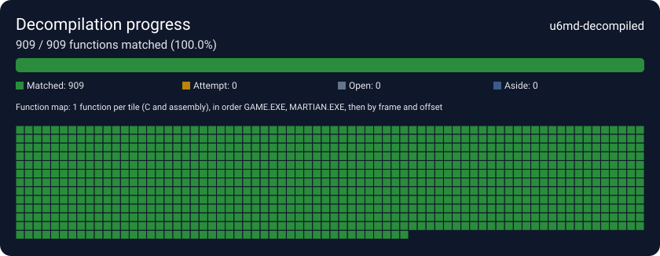

# Martian Dreams, decompiled

C and assembly sources that rebuild the two executables of *Worlds of Ultima: Martian Dreams*
(Origin Systems, 1991) with the original tools. Each one comes out byte for byte equal to the
GOG release's, header and relocation table included (for `GAME.EXE`, also its 17 VROOMM
overlays). Martian Dreams runs on Savage Empire's version of the Ultima VI engine, and the
method and tools come from the Savage Empire decompilation.

| Program | Sources | Modules | Status |
|---|---|---|---|
| `MARTIAN.EXE` (launcher, title, intro, character creation, endgame) | `SRC_M/` | 72 | identical |
| `GAME.EXE` (the game, overlaid) | `SRC/` | 77 (17 overlaid) | identical |



One tile per function of `SRC_M/` (MARTIAN.EXE) and `SRC/` (GAME.EXE, overlays included), C and assembly, regenerated by
`python3 tools/progress.py`. Grey tiles are the 9 assembly routines of GAME.EXE's OSI library (`OSILIB/LOW.ASM` and
`CLIP.ASM`) that still have an address placeholder for a name. The count reads the sources only; `tools/md/mdcheck.py`
is the byte-for-byte check.

## Reading

- [`MD-WRITEUP.md`](MD-WRITEUP.md): what the decompilation taught (the overlays, Turbo C++'s
  code shapes, how the work was organised, the comparison with Savage Empire).
- [`docs/FINDINGS.md`](docs/FINDINGS.md): the engine compared with Savage Empire's, point by point.
- [`docs/MECHANICS.md`](docs/MECHANICS.md): how the game works, from the code: formulas, chances,
  tables and conditions, with the function where each rule lives.
- [`docs/MAP.md`](docs/MAP.md): the layout of both executables.
- [`SRC_M/DECOMP.md`](SRC_M/DECOMP.md), [`SRC/DECOMP.md`](SRC/DECOMP.md): the rules of the
  sources, the tools, and the status of each program; `modules.txt` in each folder lists the
  modules in link order.
- [`docs/GAME_NOTES.md`](docs/GAME_NOTES.md): compiler notes, module by module.

## What you need

The game and the old Borland and Microsoft tools are **not** in this repository (both folders
are in `.gitignore`); you need your own copies.

| What | Where it goes |
|---|---|
| The GOG release's `MARTIAN.EXE` and `GAME.EXE` | `gamedata/MARTIAN/` (or set `MD_GAMEDIR` to the folder holding them) |
| Turbo C++ 1.00 and 1.01: 7-Zip archives of the original floppy images, file names containing `1.00` and `1.01` (e.g. `Borland Turbo CPP 1.00 5.25-360k.7z`, `Borland Turbo C__ 1.01 3.5.7z`) | `tools/` |
| MASM 3.0: `MASM.EXE`, or the floppy image (`.img`) holding it | `tools/masm300/` |
| DOSBox (tested: GOG's DOSBox 0.74-2) or DOSBox-X | on the `PATH`, or `MD_DOSBOX=path`, or the GOG release's `DOSBOX/` folder copied to `gamedata/DOSBOX/` |
| 7-Zip (`setup.py` only) | `7z` on the `PATH`, `C:\Program Files\7-Zip\`, or `SEVENZIP=path` |
| Python 3.8 or later (tested: 3.13) | |

Setting up, building and checking use only Python's standard library. The analysis tools
need `capstone` (disassembly: `mddis.py`, `mdfunc.py`, `modmap.py`, `dsrefs.py`, and
`mdcmp.py`/`mdcheck.py` when they show a difference) and `rapidfuzz` (`mdmatch.py`):

```bash
python -m venv .venv && . .venv/Scripts/activate   # .venv/bin/activate elsewhere
pip install capstone rapidfuzz
```

Copying the GOG install folder's contents into `gamedata/` gives both `gamedata/MARTIAN/` and
`gamedata/DOSBOX/`. The sources match the GOG release; other releases' executables may differ.

## Building

From the repository root:

```bash
python tools/md/setup.py                    # once: unpack tools/tcpp100, tools/tcpp101, tools/masm300/MASM.EXE
python tools/md/mdbuild.py --target martian # build MARTIAN.EXE in DOSBox, compare with the original
python tools/md/mdbuild.py --target game    # build GAME.EXE, compare with the original
python tools/md/mdcheck.py --target martian # compile and compare every module on its own
python tools/md/mdcheck.py --target game
```

Each build takes well under a minute; DOSBox runs headless. A successful build ends with:

```
MARTIAN.EXE 118480 bytes sha1 5e0e77776cdfe1222254ae4663c9f252a2271780; original 118480 bytes sha1 5e0e77776cdfe1222254ae4663c9f252a2271780
identical to the original
```

```
GAME.EXE 341712 bytes sha1 6b6b91fd6291d6d4d7b91615e5b6333c3e2b68a8; original 341712 bytes sha1 6b6b91fd6291d6d4d7b91615e5b6333c3e2b68a8
identical to the original
```

and `mdcheck.py` with `72 of 72 modules decompiled, 0 failing` (martian) and `77 of 77 modules
decompiled, 0 failing` (game). If the build differs, `mdbuild.py` lists where, by module;
`--keep DIR` keeps the objects, map and executable, `--log` prints the compiler output.

The toolchain is Origin's: Turbo C++ 1.00 (`TCC`, `C0M.OBJ`, `CM.LIB`, and `OVERLAY.LIB` for
`GAME.EXE`'s overlays), Turbo C++ 1.01 for the library C files that name it, and TLINK 3.0, with
MASM 3.0 standing in for TASM. Every tool in `tools/md/` takes `--target martian|game`.

## Dialogue

`tools/md/dialogue_export.py` writes the conversation scripts of `TALK.LZC` as JSON
(`dialogue.json`, `dialogue_text.json` hold the result for the GOG release):

```bash
python tools/md/dialogue_export.py -o dialogue.json
python tools/md/dialogue_export.py --format text -o dialogue_text.json
```

## Layout

| Path | What |
|---|---|
| `SRC_M/` | `MARTIAN.EXE`'s sources, `modules.txt`, `DECOMP.md` |
| `SRC/` | `GAME.EXE`'s sources (`LIB/`, `OSILIB/`: Origin's libraries), `modules.txt`, `DECOMP.md` |
| `tools/md/` | build, check, compare, disassembly and symbol tools; `*_syms.txt` symbol tables |
| `tools/se/` | Savage Empire's tools, which `tools/md/` was forked from (reference) |
| `docs/` | findings, executable map, compiler notes, plan, matching tables |
| `MD-WRITEUP.md`, `SE-WRITEUP.md`, `U6-LESSONS_DECOMPILATION.md` | write-ups of Martian Dreams and the two earlier decompilations |
| `gamedata/`, `tools/*.7z`, `tools/tcpp100/`, `tools/tcpp101/`, `tools/masm300/` | your copies of the game and tools (not in git) |
| `build/` | scratch output (not in git) |
